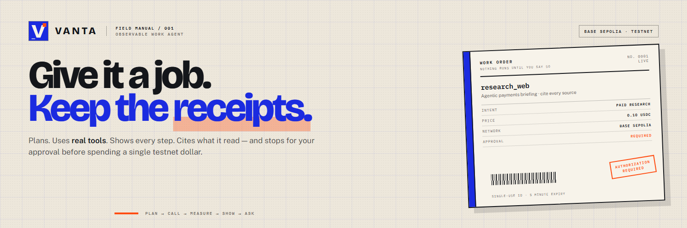
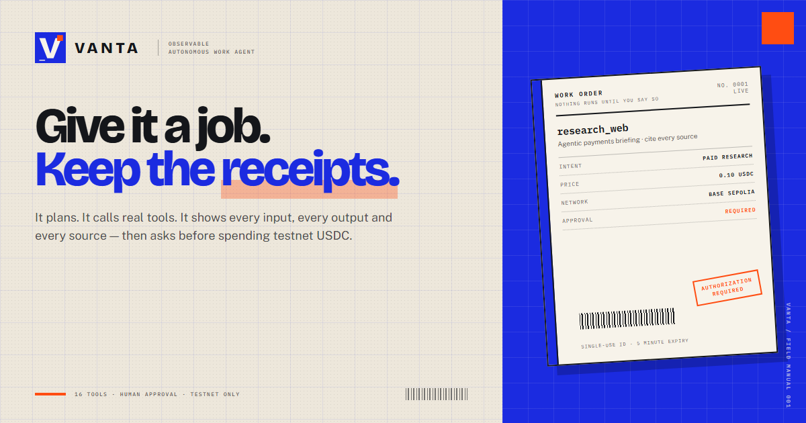
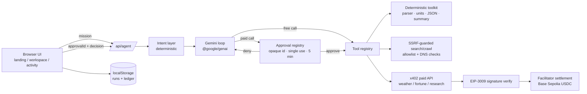
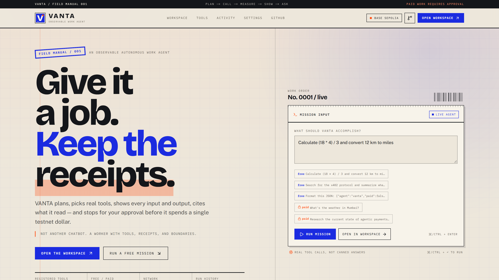
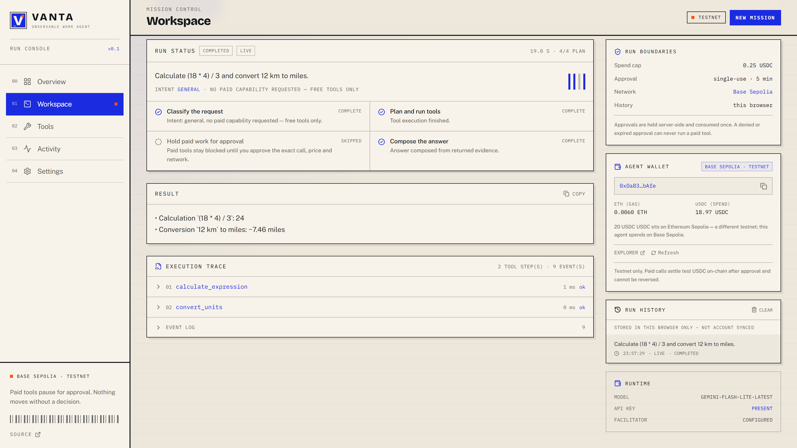
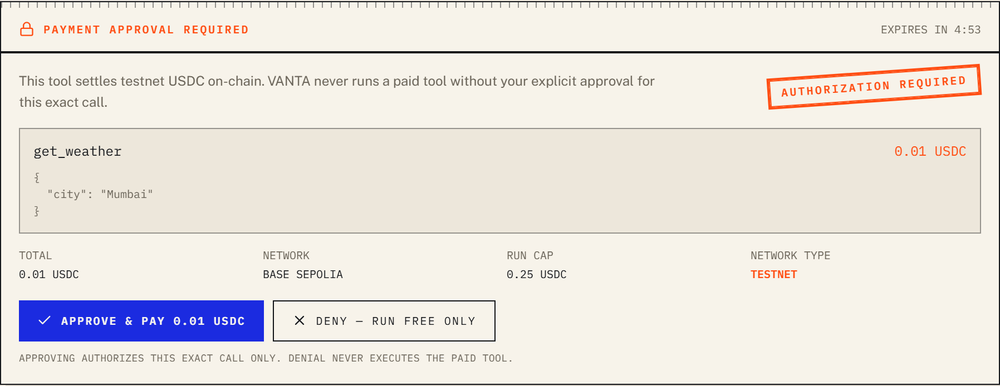
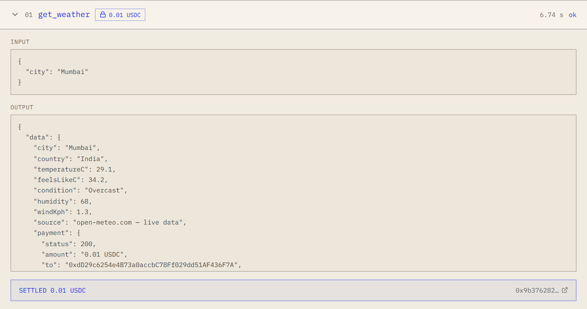
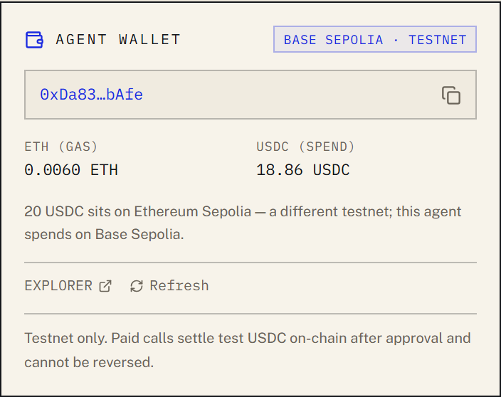
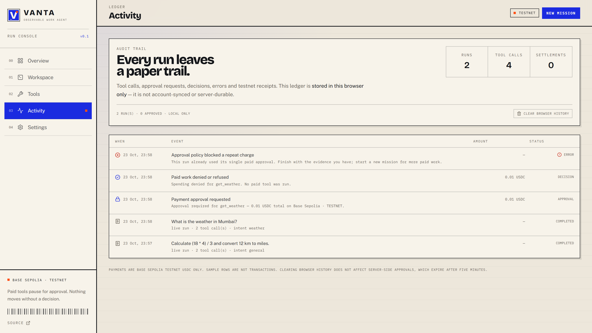

<p align="center">
  
</p>

# VANTA

**Give it a job. Keep the receipts.**

VANTA is an observable autonomous work agent. It takes a goal, classifies what the request actually needs, plans the work, runs real tools, shows every input and output, cites what it read — and **stops for a server-verified approval before spending testnet USDC**.

> Not another chatbot. A worker with tools, receipts, and boundaries.

<p>
  <code>NEXT.JS 16</code> · <code>REACT 19</code> · <code>16 TOOLS</code> · <code>BASE SEPOLIA TESTNET</code> · <code>HUMAN APPROVAL</code>
</p>

- **Week 3 crypto demo — real settlement:** [`artifacts/demo/vanta-crypto-demo.mp4`](artifacts/demo/vanta-crypto-demo.mp4) — 57.88s, 1920×1080, **0.01 USDC settled on Base Sepolia** ([tx `0x9b376282…52f9`](https://sepolia.basescan.org/tx/0x9b376282b627a2d8cadb0a05a770dbbedfa16dfe9b670a8c8802784c7a7352f9), block 49,311,297, status `0x1`)
- **Watch the 64-second product film:** [Google Drive](https://drive.google.com/file/d/1WK4hn56ABNUuTaWi2XbBjuhAqFMdZNRw/view) — the verified local master is [`artifacts/demo/vanta-explainer.mp4`](artifacts/demo/vanta-explainer.mp4)
- **Brand kit:** [download the ZIP](public/brand/vanta-brand-kit.zip) — X profile, X header, social card, SVG marks and product captures
- **Week 3 submission sheet:** [`SUBMISSION.md`](SUBMISSION.md) — links, chain proof and the remaining upload step
- **Local workspace:** run `npm run dev` and open the printed URL; open `/brand` for the live asset page
- **Existing production deployment:** <https://agentmaxxing-boredooms-projects.vercel.app> — not redeployed or re-verified during this build
- **Repository:** <https://github.com/Boredooms/Agentmaxxing>
- **Product X account (supplied):** <https://x.com/nightproof67> — a separate VANTA product handle is **pending creation**; no new handle is claimed here

> Naming note: **VANTA** is a working product name used consistently in the UI and metadata. Its domain/trademark availability has **not** been checked. The GitHub repository, Vercel project and domain were not renamed.

---

## The problem

AI agents are usually one of two things:

1. a chat interface that *talks* about work, or
2. an automation that touches tools and money with no legible boundary.

VANTA is built for the gap between them: an agent that can do useful work with real tools, while every action is inspectable and every payment is a human decision.

**Primary demo mission:** *“Research the current state of agentic payments, compare several sources, and prepare a concise cited briefing. Show me each step and ask before using a paid tool.”*

The agent selects the research tool, pauses for approval, executes the SSRF-guarded crawl, displays real source titles/URLs, and composes a cited answer. A free-only mission (calculation, unit conversion, JSON, extractive summary, checklist, URL check, search) works without a wallet or any spend.

**Differentiator:** the execution trace and the approval boundary are not decorations. They are generated by the same server-side loop that performs the work, and the browser never receives the state needed to resume a paid run.

---

## Week 3 — the crypto capability

VANTA has a **server-held Base Sepolia agent wallet**, a real x402 paid endpoint, EIP-3009 settlement, an approval gate and an on-chain receipt. The wallet is not a browser wallet connect; it is an agent account that the server reads and signs with, and the browser only ever gets public balances and an explorer link.

| Week 3 requirement | What is implemented |
| --- | --- |
| Set up a wallet | Testnet EOA (`0xDa83…bAfe`) with ETH for gas and USDC for spend; balances read from Base Sepolia |
| Add Base Sepolia | Hard-coded testnet chain config; explorer links; no mainnet path |
| Wallet in the project | `/api/wallet` returns address/balances; the workspace and settings show a live wallet card |
| Crypto capability | Paid tools are x402 resources: challenge → EIP-3009 signature → facilitator verification → USDC settlement |
| Human boundary | Opaque, single-use, 5-minute approval id; denial never invokes the paid tool |
| On-chain proof | [0.01 USDC weather settlement](https://sepolia.basescan.org/tx/0x9b376282b627a2d8cadb0a05a770dbbedfa16dfe9b670a8c8802784c7a7352f9) — block 49,311,297, status `0x1`; wallet 18.87 → 18.86 USDC |
| Demo | [`vanta-crypto-demo.mp4`](artifacts/demo/vanta-crypto-demo.mp4) + [`CRYPTO_DEMO_SCRIPT.md`](artifacts/demo/CRYPTO_DEMO_SCRIPT.md) + [`crypto/run.json`](artifacts/demo/crypto/run.json) |

**The crypto path in one line:** classify intent → select a paid tool → hold the loop → human approves → consume the approval once → verify the x402/EIP-3009 demand and nonce → settle testnet USDC on Base Sepolia → record the tx hash in the trace.

No mainnet transaction was made. The funded balance shown in the demo is testnet USDC only.

---

## Tech stack (resolved versions)

| Layer | Package / choice | Resolved in this checkout |
| --- | --- | --- |
| Framework | Next.js App Router | **16.3.8** |
| UI | React / React DOM | **19.3.0** |
| Language | TypeScript | **5.9.3** |
| Styling | Tailwind CSS + shadcn/base-ui | **4.3.3** / **4.21.3** |
| Model loop | `@google/genai` | **2.27.0** |
| Wallet / settlement | `viem` | **2.57.3** |
| Motion | Lenis + GSAP + `@gsap/react` | **1.3.27** / **3.15.0** / **2.1.2** |
| Icons | `lucide-react` | **1.52.0** |
| Browser QA | Playwright | **1.64.1** |
| Explainer | Remotion + `@remotion/google-fonts` | **4.0.450** |

---

## Design language

VANTA is styled as an **operator's field manual**, not a dark SaaS dashboard: bone paper (`#EDE7DB`), ink rules, cobalt authorization (`#1B2BE0`), safety-orange stamps (`#FF4D12`), Bricolage Grotesque display type, Public Sans body copy and IBM Plex Mono data.

The signature element is the **printed run receipt**: a real work-order panel on the landing page, receipt strips for execution trace and pricing, and a rotated authorization stamp on the payment boundary. Micro-labels and barcodes encode real metadata (network, price, approval state) rather than decorative filler. The site uses no stock images, no WebGL and no generic gradient-card grid; every visual state is generated from the app's own data.

The identity is packaged, not just described: a Cobalt field with a cream V and an orange authorization tab, a 1500×500 X header built around a real approval receipt, a 1200×630 social card, SVG marks, and 2× masters. The kit is downloadable from `/brand` and from this README.

## Brand & press kit

<p align="center">
  
  
</p>

| Asset | File | Size |
| --- | --- | --- |
| **Full kit (ZIP)** | [`vanta-brand-kit.zip`](public/brand/vanta-brand-kit.zip) | all assets + usage notes |
| Horizontal logo | [`vanta-logo.svg`](public/brand/vanta-logo.svg) | 420 × 96 SVG |
| Mark | [`vanta-mark.svg`](public/brand/vanta-mark.svg) | 64 × 64 SVG |
| X profile | [`vanta-x-pfp.png`](public/brand/vanta-x-pfp.png) · [@2x](public/brand/vanta-x-pfp@2x.png) | 400 × 400 · 800 × 800 |
| X header | [`vanta-x-banner.png`](public/brand/vanta-x-banner.png) · [@2x](public/brand/vanta-x-banner@2x.png) | 1500 × 500 · 3000 × 1000 |
| Social card | [`vanta-og.png`](public/brand/vanta-og.png) · [@2x](public/brand/vanta-og@2x.png) | 1200 × 630 · 2400 × 1260 |
| Product proof | [`approval`](public/brand/product-approval.png) · [`trace`](public/brand/product-trace.png) · [`sources`](public/brand/product-sources.png) | real app captures |
| Usage / palette / type | [`BRAND.md`](public/brand/BRAND.md) | markdown |

Upload the 400 px profile and the 1500 px header directly to X. The header keeps its headline, promise and receipt above X's lower-left avatar crop. Brand rules, palette and type specimens live in [`BRAND.md`](public/brand/BRAND.md); regenerate every bitmap with `npm run brand:assets`.

---

## Live vs demo-only

| Capability | Status |
| --- | --- |
| Gemini-driven tool loop | **Live** when `GEMINI_API_KEY` is set |
| Deterministic free tools | **Live** always |
| Deep research + citations | **Live** (paid testnet call; SSRF-guarded crawler) |
| Weather / fortune paid APIs | **Live** on Base Sepolia testnet when wallet + facilitator are configured |
| EIP-3009 USDC settlement | **Live testnet only** — verified by an on-chain testnet transaction during this build |
| Wallet balances / explorer link | **Live** reads; unreachable RPC degrades to `unavailable` |
| Run history / activity ledger | **Browser-local** (`localStorage`) — not account-synced or durable |
| Pending approvals | **Server memory**, single-use, expire after 5 minutes |
| Demo planner (no API key) | **Demo mode**, clearly labelled; runs real free tools, no model call, no payment |
| Voice walkthrough | **Optional browser Web Speech** on the landing page; no autoplay, transcript included. The explainer ships a separate local-TTS audio track |
| Explainer video | **Hosted on Google Drive** ([watch](https://drive.google.com/file/d/1WK4hn56ABNUuTaWi2XbBjuhAqFMdZNRw/view)); verified local master at [`artifacts/demo/vanta-explainer.mp4`](artifacts/demo/vanta-explainer.mp4) — 63.55s, 1920×1080, AAC voiceover |
| Week 3 crypto demo | **Local MP4** at [`artifacts/demo/vanta-crypto-demo.mp4`](artifacts/demo/vanta-crypto-demo.mp4) — 57.88s, real 0.01 USDC Base Sepolia settlement; upload before submitting a public link |

No mainnet spending path exists in this build. Nothing on this page is financial advice.

---

## Tools (16 registered)

### Paid — approval required, testnet USDC

| Tool | What it really does | Price | Limitations |
| --- | --- | --- | --- |
| `research_web` | Searches fixed free APIs, ranks candidates by title relevance, crawls up to 4 pages through the SSRF guard, returns titled excerpts + URLs | **0.10 USDC** | Crawl limited to `CRAWL_ALLOWED_HOSTS`; search sources are Wikipedia + Hacker News |
| `get_weather` | Geocodes a city and returns live current conditions from open-meteo | **0.01 USDC** | Depends on open-meteo availability |
| `get_fortune` | Returns a testnet “degen fortune” from a local route | **0.05 USDC** | Entertainment only — not a prediction |

Each paid call shows the exact tool, arguments, price, network (`Base Sepolia · TESTNET`) and run cap. Approve or deny. Only **one paid approval is allowed per run**, and the per-run ceiling (default 0.25 USDC, `MAX_RUN_SPEND_USDC`) is enforced before the card appears and re-checked when the approval is consumed.

### Free — always available

| Tool | What it really does | Limitations |
| --- | --- | --- |
| `calculate_expression` | Recursive-descent parser for numbers, `+ - * / % ^`, parentheses | No identifiers, calls, or `eval` |
| `convert_units` | Documented table for length, mass, volume, time, data, speed, area, temperature | Rejects unknown/incompatible units |
| `format_json` | `JSON.parse` + pretty print, reports syntax position | Max 100k chars; never echoes input on error |
| `summarize_text` | Deterministic extractive summary (sentence scoring) | **Not** a generative/LLM summary; labels itself extractive |
| `create_action_plan` | Validated ordered checklist, 1–12 steps | Creates the plan only — never executes it |
| `check_url_safety` | URL syntax, scheme, credentials and private-host check | **Does not fetch** the URL; not a malware scanner |
| `compare_sources` | Keyword overlap across 2–6 supplied sources: common/distinctive/gap terms | Only the supplied excerpts; keyword analysis, not fact-checking |
| `web_search` | Quick hits from Wikipedia + Hacker News JSON APIs | Titles/links only, no page text |
| `get_crypto_price` | CoinGecko simple price | Depends on CoinGecko rate limits |
| `get_country_info` | mledoze/countries dataset via jsDelivr + World Bank population | Keyless; population may lag |
| `get_joke` | Official Joke API | External availability |
| `get_my_wallet` | Agent address + ETH/USDC balances on Base Sepolia and Ethereum Sepolia | Read-only; RPC timeouts degrade to `unavailable` |
| `roll_dice` | `crypto.randomInt` dice roll | Trivial deterministic/random utility |

---

## Supported AI models

The model is read at runtime from `GEMINI_MODEL` (default `gemini-flash-latest`). Any Gemini model the API key can access is configurable; these are the IDs called out explicitly:

| Model ID | Status |
| --- | --- |
| `gemini-flash-lite-latest` | **Verified in this build** — used for the live agent runs in verification |
| `gemini-flash-latest` | Code default; supported by the SDK. Not re-verified in the latest run because the local key is pinned to the lite model |
| Other Gemini models | Configurable via `GEMINI_MODEL`; not individually verified — availability depends on the key/project |

Switch by editing `GEMINI_MODEL` and restarting the server. The active model is shown in **Settings** and on the workspace composer.

---

## Key features

- **Server-side agent loop** — Gemini → function calls → tools → results → answer, bounded to 6 model turns and 45s per tool.
- **Deterministic intent gate** — `agent/intent.ts` classifies the mission before the model sees a toolbox. Paid tools only appear when the intent clearly requests that capability. A second server-side guard rejects any unauthorized tool call.
- **Server-issued approvals** — pending runs live in a server registry keyed by an opaque UUID. The browser gets an id and a display copy only. Approvals are **single-use**, expire in **5 minutes**, and are re-validated for tool name, price, intent and budget on resume. Denial physically cannot invoke the paid tool.
- **Measured execution trace** — step number, tool, arguments, result, error, real `durationMs`, plus a sequenced event log. Nothing is timer-generated.
- **Real source evidence** — the research route returns actual crawled titles/URLs; the UI links them. No invented citations.
- **Budget guard** — per-run ceiling and one paid approval per run; paid calls blocked before a card is shown.
- **Testnet wallet** — viem EOA, ETH for gas, USDC for spend, balances from Base Sepolia, explorer links. Mainnet is not configured.
- **Honest demo fallback** — without a Gemini key, a deterministic planner runs real free tools and labels the run `demo`. It does not fake a model call or a payment.
- **Browser-local history** — runs and the activity ledger persist in `localStorage`, explicitly labelled “this browser”.
- **Field-manual product design** — bone paper, ink rules, cobalt authorization, safety-orange stamps, Bricolage/Public Sans/IBM Plex Mono, real work-order and receipt components. No template dashboard, stock imagery or fabricated metric cards.
- **Downloadable brand kit** — `/brand` ships the mark, horizontal lockup, X profile, X header, social card, product captures and a ZIP with usage notes. Bitmaps are generated from real HTML artboards with Playwright, not assembled from a template.
- **Accessible motion** — one Lenis + GSAP lifecycle, reduced-motion support, no autoplaying audio, captions/transcript for the optional voice walkthrough.
- **Reproducible explainer** — Playwright captures the real app at 2×; Remotion composes a 63.55s 1080p film with local TTS narration and burned-in captions.
- **Hardening** — SSRF-guarded crawler (host allowlist, DNS re-resolution, private-IP rejection, port restrictions, redirect re-validation), bounded JSON bodies, per-IP and per-payer rate limits, replay-resistant x402 nonces.

---

## Architecture



Request flow for a paid mission:

1. `POST /api/agent { mission }` → intent classified → Gemini is constrained to the requested paid tool on its first call.
2. The loop executes free calls, then stops before the paid call and stores the resumable turn server-side.
3. The response contains `pending: { id, calls, totalUsdc, network, expiresAt }` — no model state.
4. `POST /api/agent { approvalId, decision }` → the registry consumes the record once, re-validates it, executes (approve) or returns a denial (deny), and continues the loop.
5. The final answer, measured trace and event log replace the pending run in browser history.

---

## Screenshots

Captured from the running app by `npm run demo:record` at 2× device scale:








The landing page now also shows these captures as **printed evidence** — the approval card, the measured trace and the real source list — rather than hiding them in the repository. `/brand` packages the same proof with the X assets.

---

## Videos

### Week 3 — crypto demo (settlement path)

[`vanta-crypto-demo.mp4`](artifacts/demo/vanta-crypto-demo.mp4) — **57.88s**, **1920×1080**, 30fps, H.264, AAC stereo. This is the cut to submit for Week 3: it shows the wallet, the server-held approval, the x402 settlement and the actual Base Sepolia receipt.

| Item | Detail |
| --- | --- |
| Final film | [`artifacts/demo/vanta-crypto-demo.mp4`](artifacts/demo/vanta-crypto-demo.mp4) (7.1 MB) |
| Poster | [`artifacts/demo/crypto-poster.png`](artifacts/demo/crypto-poster.png) |
| Settlement | **0.01 USDC**, Base Sepolia, tx [`0x9b376282…52f9`](https://sepolia.basescan.org/tx/0x9b376282b627a2d8cadb0a05a770dbbedfa16dfe9b670a8c8802784c7a7352f9) |
| Chain receipt | block **49,311,297**, status **`0x1`**, gas **85,788** |
| Wallet delta | **18.87 → 18.86 USDC** |
| Storyboard + narration | [`artifacts/demo/CRYPTO_DEMO_SCRIPT.md`](artifacts/demo/CRYPTO_DEMO_SCRIPT.md) |
| Capture record | [`artifacts/demo/crypto/run.json`](artifacts/demo/crypto/run.json) |
| Reproduction | `npm run demo:crypto` then `cd video && npm run render:crypto` |
| Voice | Local Windows SAPI (`Microsoft Zira Desktop`); no cloud TTS key |

The transaction was checked with `eth_getTransactionReceipt` on `https://sepolia.base.org`. The screenshots are real captures of the approval, result, wallet before/after and expanded receipt step; the film does not mock the chain response.

### Week 1 — product explainer (denial path)

**Week 1 (vanta.v1):** [watch the hosted cut on Google Drive](https://drive.google.com/file/d/1WK4hn56ABNUuTaWi2XbBjuhAqFMdZNRw/view), or use the verified local master: [`vanta-explainer.mp4`](artifacts/demo/vanta-explainer.mp4) — **63.55s**, **1920×1080**, 30fps, H.264, **AAC stereo voiceover**. The Drive file is the user-provided hosted copy; the local file is the master used for verification. This cut deliberately shows the **denial** path, so it does not claim a settlement.

| Item | Detail |
| --- | --- |
| Hosted watch link | [Google Drive](https://drive.google.com/file/d/1WK4hn56ABNUuTaWi2XbBjuhAqFMdZNRw/view) |
| Verified master | [`artifacts/demo/vanta-explainer.mp4`](artifacts/demo/vanta-explainer.mp4) (6.8 MB) |
| Poster | [`artifacts/demo/explainer-poster.png`](artifacts/demo/explainer-poster.png) |
| Storyboard + shot list | [`artifacts/demo/DEMO_SCRIPT.md`](artifacts/demo/DEMO_SCRIPT.md) |
| Exact narration | [`artifacts/demo/narration.txt`](artifacts/demo/narration.txt) |
| Remotion source | [`video/`](video/) — six scenes, committed assets, reproducible render |
| Voice | Local Windows SAPI (`Microsoft Zira Desktop`); no cloud TTS key |
| Footage | Real app screenshots from the **denial** path; no mocked UI or claimed settlement |

Built with the [EveryInc/product-launch-video](https://github.com/EveryInc/product-launch-video) Claude Code skill plus the official [remotion-dev/skills](https://github.com/remotion-dev/skills) best practices. Render with:

```bash
cd video
npm install
npm run render
```

Verification: `ffprobe` reports 63.552s, H.264 1920×1080 at 30fps and AAC 48kHz stereo. A decoded PCM check found peak 0.548, RMS 0.059 and audible speech in all eight time segments. The `.webm` walkthrough is a separate, longer capture and is gitignored.

---

## Local setup

```bash
npm install
cp .env.example .env
npm run dev
```

Environment variable **names** only (never values):

| Variable | Required | Purpose |
| --- | --- | --- |
| `GEMINI_API_KEY` | For live mode | Enables the Gemini loop; without it the app runs the labelled demo planner |
| `GEMINI_MODEL` | No | Model ID; default `gemini-flash-latest` |
| `WALLET_PRIVATE_KEY` | For paid tools | Testnet signing wallet. `.agent-wallet.json` is used only if this is absent and the filesystem is writable |
| `FACILITATOR_PRIVATE_KEY` | For paid APIs | Server wallet that submits EIP-3009 settlement |
| `FACILITATOR_ADDRESS` | No | Display/configuration hint; the runtime derives the address from the key |
| `MAX_RUN_SPEND_USDC` | No | Per-run ceiling, default `0.25` (clamped to 5) |
| `CRAWL_ALLOWED_HOSTS` | No | Comma-separated crawl suffixes; defaults to Wikipedia, Hacker News, GitHub, MDN |

Use a **test wallet only**. Never put a wallet with real funds in this project.

### Scripts

```bash
npm run dev          # Next.js dev server
npm run build        # production build
npm run start        # production server
npm run typecheck    # tsc --noEmit
npm test             # node:test — deterministic toolkit + approval registry
npm run brand:assets # re-render X profile/header, social card and 2x masters
npm run demo:record  # real 16:9 browser video + 2x screenshots
npm run demo:crypto  # one real 0.01 USDC Base Sepolia settlement + captures
npx playwright test  # browser smoke tests (requires a running app)
```

Video renders (separate Remotion project):

```bash
cd video
npm install
npm run render        # Week 1 explainer → video/out/vanta-explainer.mp4
npm run render:crypto # Week 3 crypto cut → video/out/vanta-crypto-demo.mp4
```

For Playwright, point the tools at the running server:

```bash
VANTA_BASE_URL=http://localhost:3000 npx playwright test
VANTA_BASE_URL=http://localhost:3000 npm run demo:record
# optional: approve exactly one testnet call in the recording
VANTA_DEMO_APPROVE=1 VANTA_BASE_URL=http://localhost:3000 npm run demo:record
```

### Deployment (Vercel)

The existing Vercel project/domain was **not modified** in this build. To deploy:

1. Set `GEMINI_API_KEY`, `GEMINI_MODEL`, `WALLET_PRIVATE_KEY`, `FACILITATOR_PRIVATE_KEY` and optionally `MAX_RUN_SPEND_USDC` in the Vercel project.
2. Keep the filesystem-backed `.agent-wallet.json` out of the deployment; use `WALLET_PRIVATE_KEY`.
3. `npm run build` must pass (it does locally).
4. **Known serverless limitation:** pending approvals are stored in process memory. A multi-instance/serverless deployment can lose a pending approval between functions. This is safe (the approval fails closed) but reduces reliability. A shared store keyed by the same opaque id is the next step.
5. Deep research declares `maxDuration = 30`, so the plan must allow at least 30 seconds per function.

---

## Security notes

- **Approval tokens are server-issued and opaque.** The client cannot submit serialized model state to authorize a call; the old resume-by-contents path is rejected.
- **Single-use + expiry.** The record is deleted before any tool executes; a replayed id returns 404/409. Expired records are pruned.
- **Price/tool/intent/budget re-validation.** Approving re-checks the registered tool, its current price, the original intent policy and the remaining run budget.
- **Denial is inert.** A denied call returns a structured denial to the model and never reaches the tool runner.
- **One paid approval per run.** The model cannot ask for a second paid tool after the user decided.
- **Paid API verification.** EIP-3009 signatures are recovered and checked against the demand, resource, price, validity window and on-chain nonce before settlement. Jobs run before settlement; failed jobs are not charged.
- **SSRF defenses preserved.** The crawler enforces http(s), ports 80/443, no credentials, an allowlist, DNS resolution against private/reserved ranges, manual redirects with re-validation, timeouts and byte caps. `check_url_safety` only parses syntax and never fetches.
- **Input bounds + rate limits.** 20k request body, 2k mission, 8 history messages, 30 agent requests/min per IP, 60 paid requests/min per IP, per-payer paid limits.
- **Secrets stay server-side.** Keys are never sent to the browser, written to localStorage, prompts, logs or audit rows. Settings reports only booleans/presence.
- **No auth in this build.** It is a public demo. Do not connect a funded wallet or deploy it as a multi-user money-handling service without adding authentication, per-user spend policies and a durable approval store.

---

## Future scope (not implemented)

- **Week 2:** durable/shared approval store; per-user auth and spend policies; daily per-tool caps; approval receipts.
- **Week 3:** agent-to-agent x402 purchases; ZK spend attestations; additional tool packs; model switching UI; persistent server-backed run history.

These are roadmap items, not current capabilities.

---

## Credits and submission

Built on the [agentmaxxin](https://www.npmjs.com/package/agentmaxxin) starter for the **Agentmaxxing × Rise In Week 1** challenge. The original starter’s wallet/x402 scaffolding, crawler and Gemini loop were retained and then hardened; the product surface, deterministic tools, approval registry, trace model and UI were rebuilt as VANTA. Week 3 extends the same build with a real Base Sepolia x402 settlement and a dedicated demo cut.

### Week 3 submission checklist

- **Working crypto-enabled agent:** yes — server-held Base Sepolia wallet, x402 challenge, EIP-3009 verification, testnet USDC settlement, human approval and an on-chain receipt.
- **GitHub repository:** <https://github.com/Boredooms/Agentmaxxing>
- **Demo/video:** [`artifacts/demo/vanta-crypto-demo.mp4`](artifacts/demo/vanta-crypto-demo.mp4) — **57.88s**, real 0.01 USDC settlement. Upload this file to the submission drive or a public video host before submitting; the existing Google Drive link is the **Week 1 explainer**, not this cut.
- **Demo notes:** [`artifacts/demo/CRYPTO_DEMO_SCRIPT.md`](artifacts/demo/CRYPTO_DEMO_SCRIPT.md) · **raw proof:** [`artifacts/demo/crypto/run.json`](artifacts/demo/crypto/run.json)
- **Live deployment:** the existing Vercel deployment is **not** re-verified against this build; run locally or redeploy before sharing a live link.
- **Social:** <https://x.com/nightproof67> (supplied account). No new VANTA handle is claimed until it is actually created.

Submission tagging guidance: include **@riseinweb3** when posting the demo/submission. The challenge attribution is intentionally kept here rather than dominating the product UI.

---

## License

See [LICENSE](LICENSE).
